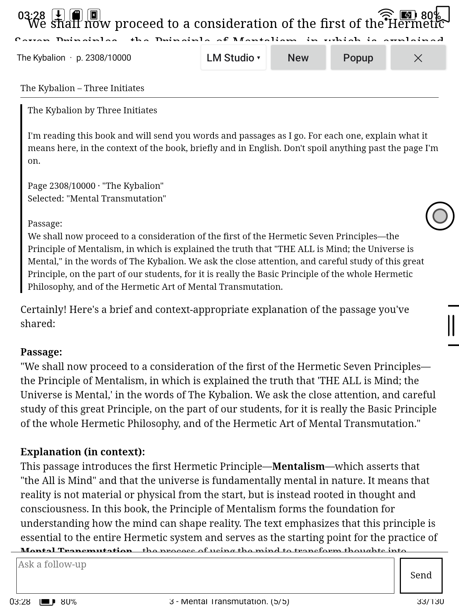
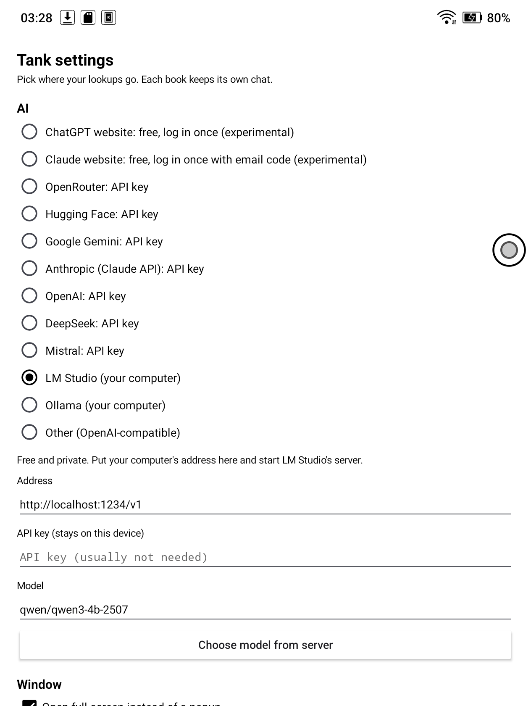

# Tank: an AI reading companion for e-readers

Select a word or passage in NeoReader, KOReader or any Android reading app and Tank explains it **in the context of the book you're reading**: which chapter you're in, what's going on, no spoilers past your page. Every book keeps its own conversation, so follow-up questions remember everything you asked before.

Bring your own AI: the ChatGPT or Claude website with your normal account, any API key you already have, or a model running on your own computer for free.

> **KOReader users: you need the Tank plugin.** KOReader only sends words to its own fixed list of dictionary apps, so the Tank app can't plug in by itself. Install `tank.koplugin` (see [KOReader](#koreader) below) and you get an **Ask Tank** button in the selection menu. On Android it opens the Tank app; on Kobo, Kindle and PocketBook it answers on its own through an API key or a local model.

<p>
  
  
</p>

> Named after the Operator who loads what you need to know straight into your head.

## Two parts

- **Tank app (Android):** works with BOOX NeoReader (as the "other dictionary"), with KOReader on Android (through the plugin below), and with any app's text-selection or Share menu. It's the only way to use the ChatGPT or Claude **website** without an API key.
- **Tank plugin for KOReader** (`tank.koplugin`): adds **Ask Tank** to KOReader's selection menu. On Android it hands the selection to the Tank app; on Kobo, Kindle, PocketBook and other KOReader devices it answers by itself through an API key or a local model, with one chat per book saved in the book's KOReader sidecar.

## What it does

- Opens from NeoReader's **dictionary menu** (as the "other dictionary"), from any app's text-selection menu, or from Share.
- Finds your selection in the EPUB and sends the **chapter and ~600 characters around it**, picking the occurrence nearest your current page.
- **One chat per book.** The first lookup tells the AI the title and author and asks for short, spoiler-free answers in context; later lookups go into the same chat.
- Plain black-on-white answer page built for e-ink, with a box for follow-up questions.
- Popup over the book, or full screen.

## Choose your AI

| Option | Cost | Notes |
|---|---|---|
| ChatGPT website | your normal plan | Log in once inside Tank. Chats are named after the book. *Experimental: drives the website, may break when it changes.* |
| Claude website | your normal plan | Log in once **with the email code**; Google sign-in doesn't work inside apps. Chats are named after the book. *Experimental.* |
| OpenRouter | pay per use | One key, hundreds of models. Default model `deepseek/deepseek-v3.2`. |
| Hugging Face | free monthly credit | Open models through the HF router. |
| Google Gemini | free tier | |
| Anthropic, OpenAI, DeepSeek, Mistral | pay per use | Direct API keys. |
| LM Studio / Ollama | free | A model on your own computer, over Wi-Fi. Private. |
| Other | | Any server that speaks the OpenAI chat API. |

API keys stay on the device (app storage, backups disabled). Every API option shows its address and model so you can change them, and **Choose model from server** lists what the server offers.

## Install

1. Download `Tank-x.y.z.apk` from [Releases](../../releases) and install it on the BOOX (enable installs from unknown sources when asked).
2. Optional, for passages: give Tank **All files access** (Settings → Apps → Tank → Permissions), so it can read your books. Without it Tank still works, it just sends the selection without the surrounding text.
3. In NeoReader, select a word → dictionary → choose **Tank** as the other dictionary.
4. Tap the AI button at the top of Tank (e.g. **ChatGPT ▾**) to pick your AI.

### KOReader

1. Download `tank.koplugin.zip` from [Releases](../../releases) and unzip it into KOReader's `plugins` folder (on Android: `koreader/plugins/`; on Kobo: `.adds/koreader/plugins/`).
2. Restart KOReader fully (menu → Exit → Restart).
3. Select text → **Ask Tank**. Choose where answers come from in the search menu (🔍) → **Tank**: the Tank app (Android), an API service, or a local model.

### Local AI over Wi-Fi

- **LM Studio:** Developer tab → start the server and enable *Serve on Local Network*. In Tank, set the address to `http://<your-computer-ip>:1234/v1` and tap *Choose model from server*.
- **Ollama:** run it with `OLLAMA_HOST=0.0.0.0`, address `http://<your-computer-ip>:11434/v1`.

## Tested on

BOOX Go Color 7 (Gen II), firmware 4.2 and 4.3.1, NeoReader. Bigme HiBreak Pro with KOReader v2026.07. Other devices should work; reports welcome.

## Limits

- Passages are found in EPUBs only. PDFs and other formats send just the selection.
- Book detection uses NeoReader's library database or KOReader's settings; other reading apps send just the selection.
- The website modes depend on the sites' current layout and may need updates when they change. The API modes don't.

## Build

```bash
./gradlew assembleDebug
```

Needs JDK 17 and the Android SDK (API 35). No third-party libraries. A signed release build reads its key from `~/.local/share/tank-signing/signing.properties` (or the path in `TANK_SIGNING`); without it, `assembleRelease` produces an unsigned APK.

## License

GPL-3.0. See [LICENSE](LICENSE).

Not affiliated with Onyx/BOOX, OpenAI, Anthropic, Google, OpenRouter, Hugging Face or any other provider named here. All trademarks belong to their owners.
